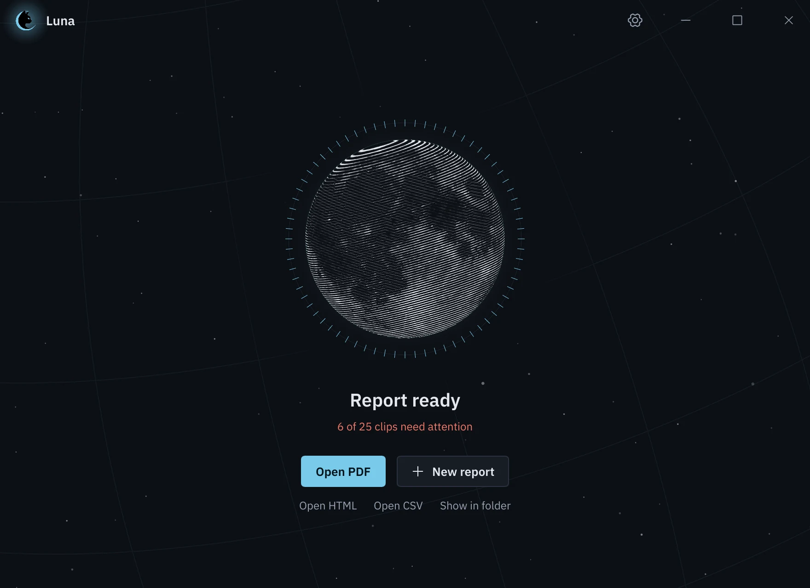
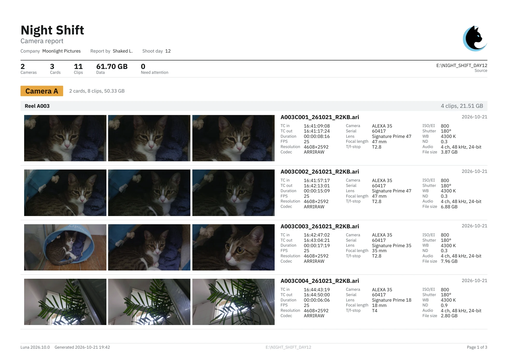
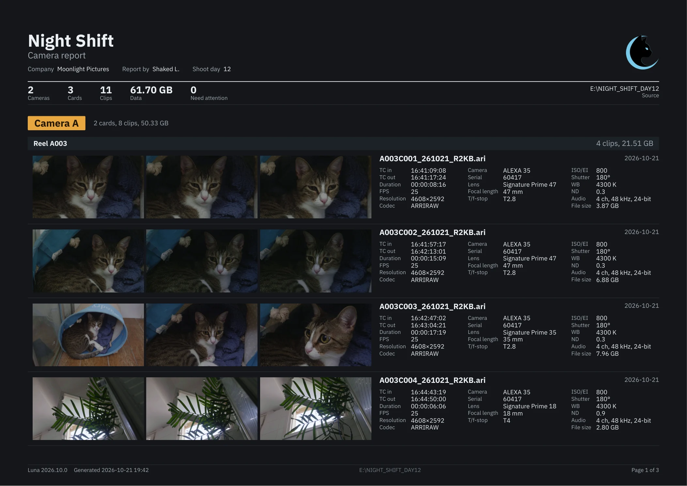

# Luna

**Beautiful reports for every camera. Free.**

Camera reports as PDF, HTML and CSV, for Windows and macOS.

[**Download**](https://github.com/shakedex/LunaApp/releases/latest) · [Website](https://luna.shaked.co) · [Formats](#formats) · [Scripting](automation/README.md)

 

## The report

Drop a card or a whole shoot drive on Luna's window. Every clip is grouped by
camera and reel, with its metadata and a strip of three stills.

<table>
  <tr>
    <td width="50%"></td>
    <td width="50%"></td>
  </tr>
  <tr>
    <td align="center">Paper</td>
    <td align="center">Dark</td>
  </tr>
</table>

## Features

| | |
| --- | --- |
| **Popular camera formats** | ARRIRAW, ARRICORE, X-OCN, R3D, BRAW, Cinema RAW Light, N-RAW, ProRes RAW and more |
| **Paper or dark** | PDF, HTML and CSV, in the Paper or Dark theme |
| **Smart Sorting** | Drop a whole drive. Every card is sorted by camera and reel from the clips themselves |
| **Your Branding** | Logo, production, company and your own fields like shoot day or location |
| **Rec.709, log or your LUT** | RAW to Rec.709, bring your own LUT, or use the embedded LUT with Camera Look on supported cameras¹ |
| **Script it** | `luna-cli` makes reports from a terminal or a script, and over MCP for AI agents ([guide](automation/README.md)) |

¹ Camera Look: Blackmagic RAW.

## Formats

| Camera            | Formats                                    |
| ----------------- | ------------------------------------------ |
| ARRI              | ARRIRAW, ARRICORE, ProRes                  |
| Sony              | X-OCN, XAVC                                |
| RED               | R3D                                        |
| Blackmagic Design | Blackmagic RAW                             |
| Canon             | Cinema RAW Light, XF-AVC, XF-HEVC          |
| Nikon             | N-RAW, R3D NE                              |
| Apple             | ProRes, ProRes RAW                         |
| Other cameras     | H.264, HEVC                                |

Sidecars: Sony and Canon XML, RED RMD, Blackmagic RAW sidecars and ALE. Every
format reads on both Windows and macOS. Missing one?
[Open an issue](https://github.com/shakedex/LunaApp/issues).

## Download

| | Installer | Requires |
| --- | --- | --- |
| **Windows** | `Luna-<version>-windows-x64-setup.exe` | Windows 10 or 11, x64 |
| **macOS** | `Luna-<version>-macos.dmg` | macOS 26 or later, Apple silicon |

Both are on the [latest release](https://github.com/shakedex/LunaApp/releases/latest).
Luna updates itself.

The Windows installer is unsigned, so SmartScreen shows "Windows protected
your PC": choose **More info**, then **Run anyway**. The macOS app is signed
and notarized.

With **Also save on the source drive** on in Settings (off by default), each
report is also written to `Luna\<report name>\` at the root of the source
drive (`D:\Luna\…`, `/Volumes/<drive>/Luna/…`), unless the report destination
is already on that drive.

## Development

Building Luna, releasing and the repo layout are in
[DEVELOPMENT.md](DEVELOPMENT.md).

## License

The source in this repository is under the [MIT License](LICENSE).

The installers also contain components that are not MIT: Luna's closed-source
decoders, the R3D add-on under its own [EULA](packaging/R3D-EULA.txt), the
Blackmagic RAW SDK libraries, and FFmpeg under the LGPL. [NOTICE](NOTICE)
lists each one with its licence.
